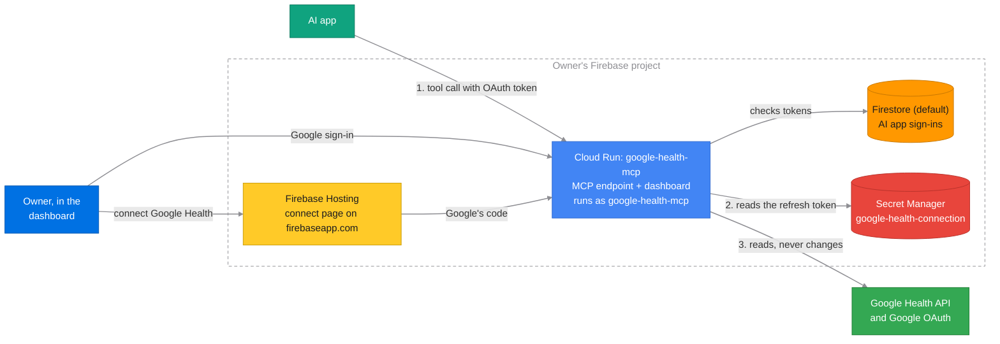

# Private AI connector for Google Health

Ask your AI app about your sleep, heart rate, HRV and the rest of your Google
Health data, from a private, read-only connector that runs in your own Firebase
project. Any AI app that supports MCP connectors can use it.

- **Yours alone.** Each person deploys their own copy into their own Firebase
  project. Your data goes from Google Health to
  your project to the AI app you connect, and nowhere else: there is no shared
  server, and the developer never sees it.
- **Read-only.** The AI gets seven read tools. Nothing can write to or delete
  from your Google Health data.
- **Google's own data, unchanged.** Each tool is one method of the
  [Google Health API](https://developers.google.com/health), and answers with
  Google's JSON as it is. The AI does the analysis; the connector only keeps
  each answer small enough to read.

This project is unofficial and not affiliated with Google. It uses the public
Google Health API (v4) with your project's own OAuth client.

## Why this exists

I wanted my AI app to look at my sleep over months, night by night, with the
heart rate and HRV behind it, not just the scores an app shows. The Google
Health API has all of it, and its design follows Google's API Improvement
Proposals (AIPs), so a thin pass-through is enough: the AI already knows how to
page, filter and roll up.

## How to use

### 1. Create a Firebase project

[Create a new project](https://console.firebase.google.com/) and upgrade it to
the Blaze plan. For one person, it stays within the no-cost tier.

### 2. Run the setup

Click this button. It opens Google Cloud Shell with a setup guide on the right.

[](https://shell.cloud.google.com/cloudshell/editor?cloudshell_git_repo=https://github.com/induction-axiom/ai-connector-for-google-health&cloudshell_git_branch=stable&cloudshell_tutorial=docs/cloudshell-tutorial.md&show=terminal)

When Cloud Shell asks, tick **Trust repo**. Then follow the guide. It takes
a few minutes and ends with your dashboard link. Bookmark it.

### 3. Connect Google Health

First sign in once to the Google Health app on your phone, with the Google
account whose data you want to share. It can be a different account from the
one that owns the connector.

Then open the dashboard, sign in with Google, and choose **Connect Google
Health**. A page on your project's `firebaseapp.com` address opens; choose
**Continue with Google**, pick the account with your health data, and allow
everything Google asks.

Google warns that it hasn't verified the app. It is your own connector, in your
own project, so choose to continue. Removing that warning would take Google's
review of the app, which is meant for apps used by many people.

There is no OAuth client to create. Firebase already made one for the
dashboard's Google sign-in, and it allows your `firebaseapp.com` address, so
the setup reuses it: it copies the client into Secret Manager and publishes
the connect page there.

### 4. Connect your AI app

In the dashboard, under **AI apps** → **How to connect**, copy the address and
choose your app to see what to do. **Another app** covers any other app that
supports MCP.

When the AI app sends you to approve the connection, only allow it if you
just chose Connect in that app yourself. Someone else can send you a link
that looks the same.

## Later

- **Lost the dashboard link?** Ask your AI app for it.
- **Updating.** The dashboard shows a banner when a new version is out. Click
  **How to update**. Your Google Health connection and AI app connections stay.
- **Removing it.** Disconnect Google Health and your AI apps in the dashboard,
  then delete the Firebase project (**Project settings → General → Delete
  project**). Your Google Health data is unchanged.

## How your data is handled

Your connector asks Google Health each time your AI app calls a tool and passes
the answer on. It keeps no health data. Your project keeps its Google OAuth
client and Google's refresh token, in Secret Manager, which only the connector
can read; the AI app sign-ins you approved; and the last error Google gave.

The connector asks Google for five read-only scopes: sleep, health metrics and
measurements (heart rate, HRV, SpO2, respiratory rate, temperature, weight…),
activity and fitness, profile, and settings (which also covers paired
devices). It never asks for write scopes, ECG, irregular-rhythm notifications,
exercise GPS routes or reproductive health.

## The tools

| Tool | Google Health API method |
|---|---|
| `describe_data_type` | Reads Google's discovery document: every data type, and for one type its schema, roll-ups, filter syntax and notes |
| `list_data_points` | `GET users/me/dataTypes/{type}/dataPoints` |
| `reconcile_data_points` | `GET users/me/dataTypes/{type}/dataPoints:reconcile` |
| `roll_up_data_points` | `POST users/me/dataTypes/{type}/dataPoints:rollUp` |
| `daily_roll_up_data_points` | `POST users/me/dataTypes/{type}/dataPoints:dailyRollUp` |
| `get_resource` | `GET` of `users/me/identity`, `profile`, `settings`, a paired device, or one data point |
| `list_paired_devices` | `GET users/me/pairedDevices` |

What the connector adds to Google's answers, and nothing else:

- **A size limit.** An answer over 60,000 characters (about 15,000 tokens)
  doesn't reach the AI. It gets `result_too_large` instead, with how many items
  there were and a `page_size_that_fits`, and asks again for less: a smaller
  page, a shorter range, a `fields` mask, or a roll-up. Heart rate is kept per
  second, so this matters.
- **Notes.** `describe_data_type` adds a few notes Google's schemas don't
  carry, such as using `reconcile_data_points` for sleep so one night isn't
  counted twice. They live in `NOTES` in `firebase/mcp/tools.py`, the one part
  kept by hand.
- **Short source-family names.** `data_source_family` takes `google-wearables`
  and the connector sends Google's full `users/me/dataSourceFamilies/…` name.

Expected failures, such as an expired connection, come back as results with
`error_code` and `next_action`, and a link to the dashboard when the owner
needs to act.

## Development

```text
firebase/
  mcp/        MCP server, Google Health client, tools, dashboard
  hosting/    The connect page, published on <project>.firebaseapp.com
  scripts/    bootstrap.sh, manage.py (bootstrap, deploy, doctor, urls)
tests_mcp/  tests_deployment/  tests_ui/
docs/cloudshell-tutorial.md     The Cloud Shell guide
```

Deploy after a change, then check the access boundaries:

```sh
python3 firebase/scripts/manage.py deploy --project YOUR_PROJECT_ID
python3 firebase/scripts/manage.py doctor --project YOUR_PROJECT_ID
```

Run the tests, with the packages in `firebase/mcp/requirements.txt` installed:

```sh
python3 -m unittest discover -s tests_mcp -t tests_mcp
python3 -m unittest discover -s tests_deployment -t tests_deployment
(cd tests_ui && npm ci && npx playwright test)
```

`tests_mcp/discovery_v4.json` is Google's discovery document for the Health
API, saved at the revision it names. The fake Google in the tests answers only
requests that match a method in it, with parameters it declares. To check
against a newer API, save the current one over it:

```sh
curl -o tests_mcp/discovery_v4.json 'https://health.googleapis.com/$discovery/rest?version=v4'
```

### Architecture



There are two separate sign-ins. Your AI app signs in to your connector, which
is its own OAuth server and gives the app a token for this connector only. The
connector signs in to Google Health with the refresh token you granted, which
never leaves your project.

Granting it goes through the connect page because of where Google sends its
answer. Google only hands an authorization code to an origin its OAuth client
lists, and Firebase's client lists `<project>.firebaseapp.com`, not the Cloud
Run address, which no API can add. So the dashboard links to the connect page
there, with a one-time state. The page opens Google's popup, and sends the
code and state to the connector, the one cross-origin call the connector
accepts. The connector exchanges the code with the client secret, and saves
the refresh token.

A tool call, step by step:

1. The AI app calls `/mcp` on Cloud Run with an OAuth token the owner approved
   once with Google.
2. If it has no access token from the last hour, Cloud Run reads the refresh
   token from Secret Manager and asks Google for one. Only the
   `google-health-mcp` identity can read or change the secret.
3. It calls the Google Health API, and returns Google's answer if it fits.

Resource names are fixed in `firebase/scripts/configuration.py`. Nothing is
saved locally: `manage.py` finds the deployed `google-health-mcp` service and
reads its region, owner and Firebase config from it.

This project started as a copy of
[ai-connector-for-spliit](https://github.com/induction-axiom/ai-connector-for-spliit),
which shares its sign-in, dashboard and setup.

## License

Copyright (C) 2026 Jong Luo. Licensed under the GNU Affero General Public
License v3.0 only (AGPL-3.0-only). See [LICENSE](LICENSE).
